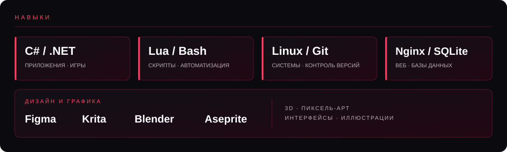

<h2>dan4ikk3</h2>

<i>Разработка · Linux · игровые проекты</i>

## Обо мне

Пишу на **C# / .NET**, изучаю Linux и участвую в разработке игровых проектов на базе Space Station 14.

## Проекты

## Статистика

 

Спасибо, что заглянул!

