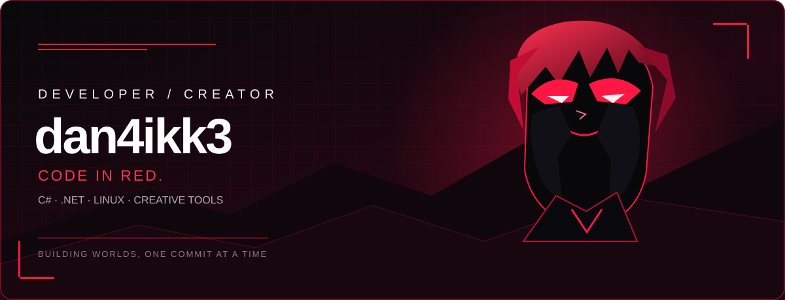
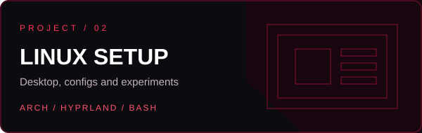
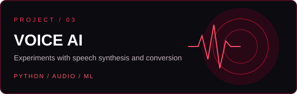
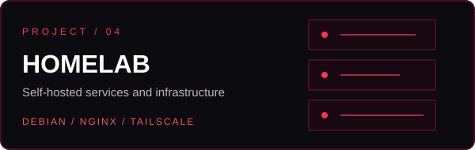

<div align="center">



<br/>

[](https://github.com/dan4ikk3)
[](https://github.com/dan4ikk3)

</div>

## whoami

```text
dan4ikk3 — developer, Linux tinkerer, and game systems enthusiast.
I like building things, breaking them, and figuring out why they broke.
```

- 🔻 Working with **C# / .NET**, scripts, and game systems.
- 🐧 Running and customizing **Linux** setups.
- 🛰️ Contributing to **Space Station 14** community development.
- 🎨 Interested in design, 3D, pixel art, and audio/AI experiments.


## projects

<div align="center">

<a href="https://github.com/dan4ikk3/fish-station"></a>







</div>

## github stats

<div align="center">

<a href="https://github.com/dan4ikk3"></a>
<a href="https://github.com/dan4ikk3"></a>

<br/>


</div>

## contact

<div align="center">

[](https://github.com/dan4ikk3)


</div>
